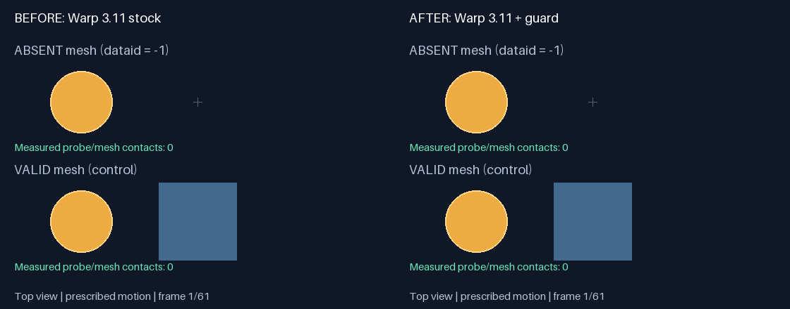

# Absent mesh slots produce phantom contacts in MuJoCo-Warp 3.11

Minimal collision reproducer for the **MjLab 1.6.0 / MuJoCo 3.11.0 / MuJoCo-Warp 3.11.0** baseline. A mesh whose per-world `geom_dataid` is `-1` should be absent. Stock Warp 3.11 still generates probe contacts for this slot. The guard rejects absent meshes in broadphase, while keeping valid meshes and primitives collidable.



[Side-by-side MP4](media/comparison.mp4) · [Before MP4](media/before.mp4) · [After MP4](media/after.mp4)

The animated preview is embedded as a GIF so GitHub README rendering works without external video hosting; full-resolution MP4 files are included alongside it.

## Reproduce

Install [uv](https://docs.astral.sh/uv/getting-started/installation/), then from this repository root:

```bash
uv sync --locked
uv run --locked scripts/reproduce.py
```

This uses Python 3.11 and a committed lockfile. CPU is the default; no GPU, Torch, MjLab installation, display server, system FFmpeg, Hugging Face account, motion dataset or robot assets are needed. Initial installation needs network access; subsequent runs reuse the environment and Warp kernel cache. Kernel compilation takes additional time on a cold cache.

Optional CUDA execution, on a machine with a compatible NVIDIA driver:

```bash
uv run --locked scripts/reproduce.py --device cuda:0
```

Outputs:

- `media/{before,after,comparison}.mp4`, `media/comparison.gif`, and a representative PNG.
- `outputs/{before,after}.json`: every measured frame and contact count.
- `outputs/summary.json`: assertions and measured execution time.
- `outputs/{before,after,regression}.log`: backend logs and eight regression cases.

The command exits unsuccessfully unless stock produces absent-mesh contacts, the patch removes them, and the entire valid-mesh contact sequence is unchanged. It also checks both NXN and SAP_TILE across single-world, broadcast-absent, mixed-world and broadcast-valid layouts, including valid mesh/floor contacts.

## What the animation shows

This is a **top-view collision diagnostic**, not a free-dynamics rollout or a reproduction of a robot knocking over a lamp. The sphere follows the same prescribed 61-position sweep in both runs. Each frame calls real MuJoCo-Warp `kinematics` and `collision`; the red line indicates a measured probe/mesh contact pair, not a contact normal or force. The small cross denotes the absent slot's origin; it is not a physical object. The lower panel retains the cube as a positive control. Rendering uses Pillow and therefore needs no OpenGL.

The asset is an inline eight-vertex cube, plane and sphere in `assets/scene.xml`. Two worlds share the compiled model; only world zero's mesh data ID is set to -1, matching the missing-part representation relevant to MjLab variants. No Weave data or third-party mesh is included. The fixture intentionally intersects the valid cube with the floor to exercise primitive collision handling as well.

## Patch isolation and scope

`scripts/patch.py` contains the small backend source transformation. The runner verifies the stock 3.11 collision driver's SHA-256 and applies the transformation to an ignored private copy under `.runtime/fixed/`. Stock and patched workers run in separate processes; the installed package and other environments are never modified. All other model state, trajectory and dependencies are identical.

The source guard is needed in **MuJoCo-Warp**, not in MuJoCo's CPU engine. MjLab provides the relevant variant layout; the standalone backend fixture deliberately omits MjLab for fast installation. This repository does not independently test MjLab integration or training behavior. The companion PR materials contain the MjLab integration regression.

This targets a **3.11 backport**, not an assertion that current upstream main still has the same bug. Newer upstream missing-mesh work must be considered when choosing the PR destination. It does not upgrade to 3.15 or change actuator interfaces.

## Observed CPU result

On the development machine, the complete command took 10.91 seconds with existing Warp kernel caches (installation excluded). Out of 61 frames, stock produced absent-slot contacts in 15 frames; patched produced zero. The valid mesh produced contacts in 33 frames in both runs, with identical per-frame counts. All eight fixed-backend regression cases passed. Fresh kernel compilation and download time vary by machine; this is not a cold-start timing guarantee. CUDA execution is provided as an option and has not been validated in this standalone environment.

All fixture geometry was created synthetically for this reproducer. The videos are generated from recorded collision results, not manually authored contact labels.
